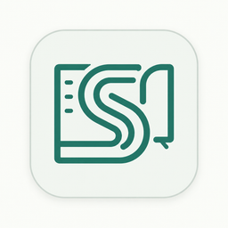
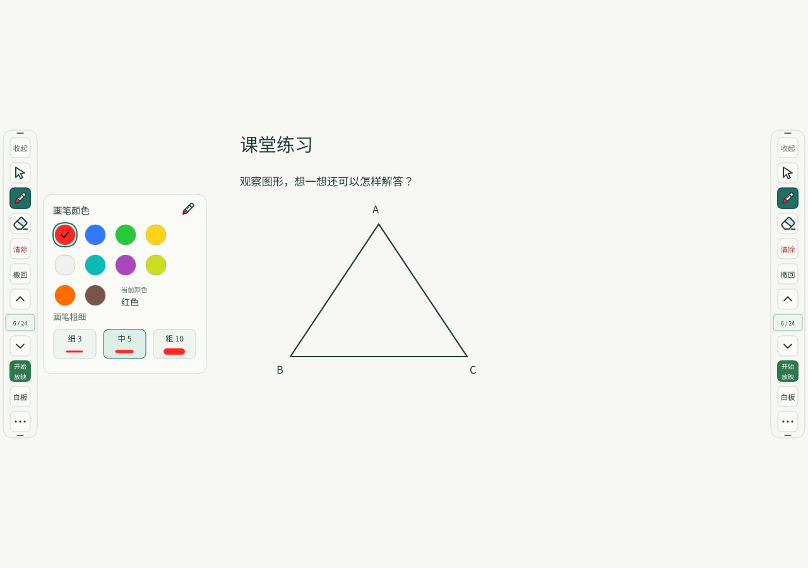
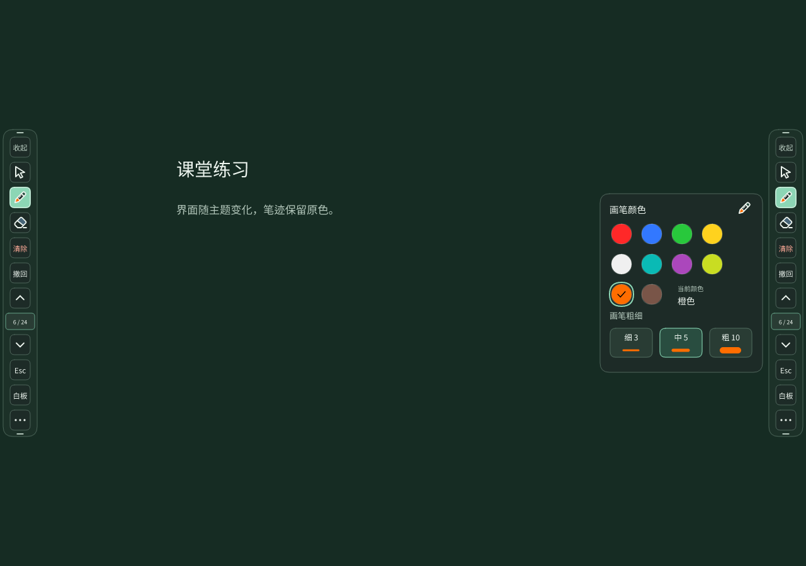
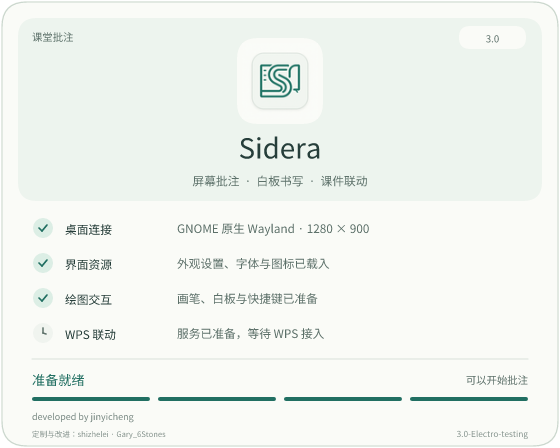
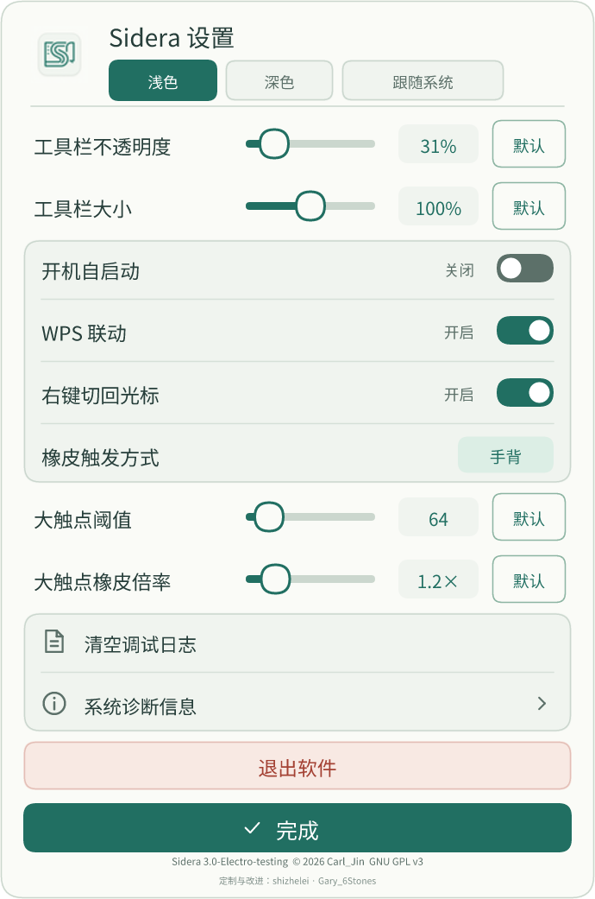
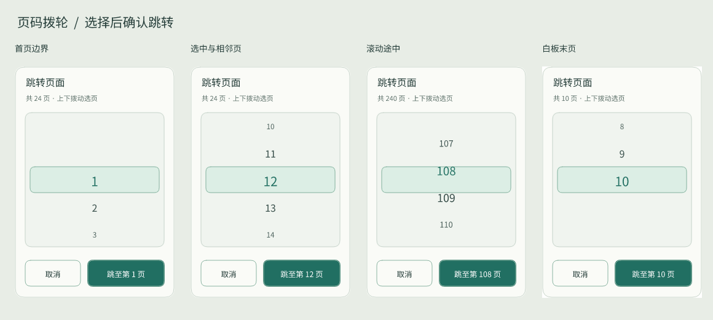
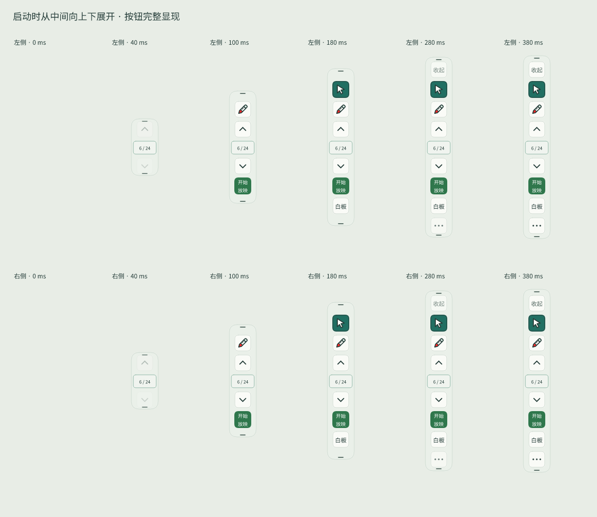

<div align="center">



# Sidera · 星罗

**Linux 课堂批注 · 白板书写 · WPS 演示联动**

浅色与深色课堂界面，清晰工具，把注意力留给课堂。

[](https://github.com/shi-zhe-lei/Sidera--screen-annotate-for-linux/tree/custom)
[](https://github.com/shi-zhe-lei/Sidera--screen-annotate-for-linux/releases)
[](#桌面与安装包兼容性)
[](LICENSE)

[下载测试版](https://github.com/shi-zhe-lei/Sidera--screen-annotate-for-linux/releases) · [界面预览](#界面预览) · [安装指南](#安装与开始使用) · [更新记录](CHANGELOG.md) · [参与贡献](CONTRIBUTING.md) · [安全政策](SECURITY.md) · [许可证](LICENSES.md)

</div>

> **这是基于原项目的定制分支，并非原创项目。**
>
> Sidera 原项目来自 [offduckling4825/Sidera--screen-annotate-for-linux](https://github.com/offduckling4825/Sidera--screen-annotate-for-linux)，保留原作者 **Carl_Jin / jinyicheng** 的署名和授权声明。本分支由 **shizhelei · Gary_6Stones** 进行课堂体验与兼容性改进，不代表上游官方发行版。

当前开发集中在 **Rust 3.0 的 `custom` 分支**；仓库也保留上游 C++ / Qt5 2.6 实现。下面介绍的是本分支 Rust 版，不表示 C++ 版已同步这些改动。当前发行：[2026.10.25 · custom.35 · 小屏幕设置修复](https://github.com/shi-zhe-lei/Sidera--screen-annotate-for-linux/releases/tag/v3.0-Electro-testing-custom20261025.35)。

## 界面预览

<p align="center">
  
</p>

<p align="center"><sub>生产绘制代码生成的静态预览；课堂背景与页码为演示数据，不是桌面实测截图。</sub></p>

<details>
<summary>查看深色课堂界面（custom.35，amd64 / ARM64）</summary>



在设置顶部选择 **浅色 / 深色 / 跟随系统**，立即生效并保存。工具栏、弹窗、设置和启动页统一适配；白板底色与实际笔迹保持原样。参见[主题使用与验证范围](docs/DARK_MODE.md)。

</details>

<table>
<tr>
<td width="50%" valign="top" align="center">
<b>启动准备</b><br><br>
<br>
<sub>实际准备状态、原作者署名与辅助贡献署名。</sub>
</td>
<td width="50%" valign="top" align="center">
<b>设置与触摸</b><br><br>
<br>
<sub>细致调节、逐项恢复默认，保留原有操作位置。</sub>
</td>
</tr>
</table>

<details>
<summary>查看页码拨轮与工具栏展开分帧</summary>





浅色预览与分帧由 [render_ui](rust/examples/render_ui.rs) 生成，深色预览由 [render_themes](rust/examples/render_themes.rs) 生成，均使用实际界面绘制函数。分帧用于展示设计，不能替代真实动画、输入与桌面兼容性验收。

</details>

## 为课堂准备的操作

| 功能 | 当前行为 |
| --- | --- |
| 屏幕批注 | 画笔、橡皮、撤回与清除；光标模式把工具栏外的点击交还给桌面。 |
| 工具与反馈 | 笔尖跟随所选颜色，橡皮图标随尺寸适度变化；选中态明显，取消悬浮反馈，强化按下反馈。 |
| 绘图工具组 | 默认收起橡皮、清除与撤回，保留画笔与翻页入口；选画笔展开，清除后收回，光标模式下空画布在切换或翻页后收回。返回有笔迹页自动展开；白板模式保持展开。 |
| 工具栏拖动 | 上下两个拖拽点，拖动高亮，范围限制在屏幕内；整栏收起后只留边缘小角，不自动弹开。 |
| 白板 | 进入即切换画笔，光标按钮禁用；关闭再打开保留本次运行的内容与页码。保持原来的白色／绿板切换，底色不跟随界面主题。**退出程序后不持久保存笔迹。** |
| WPS 联动 | 联动在线且 WPS 支持“当页开始”时显示绿色“开始放映”，从当前页启动；联动放映中显示“结束放映”。真实换页切换批注，页内动画不切换页缓存。 |
| 页码与跳页 | 显示当前页 / 总页数；页码有效且联动跳页可用时，点击页码打开拨轮，选好后点“跳转”。未联动或两项页码均未知时隐藏；白板使用自身页码与拨轮。 |
| 未接入 WPS | 上下键与 Esc 回退到桌面支持的直接按键模拟，页码区域隐藏；不因翻页发起共享桌面授权。 |
| 启动与外观 | 浅色、深色或跟随系统，保留课堂配色与触摸反馈；启动页显示实际准备信息，两侧工具栏从中间向上下展开。工具栏大小以 1% 步长调节。 |

放映按钮、页码及翻页不可用时的具体表现见 [WPS 按钮与页码状态](wps-addin/README.md#按钮与页码状态)。截图、原生剪贴板、多屏画布和触摸处理的能力随桌面后端不同；请结合下面的兼容性范围使用。

## 桌面与安装包兼容性

**桌面后端支持和 DEB 能否安装是两件事。** 还需要匹配处理器架构与系统库版本。

| 桌面环境 | 实现路径 | 使用边界 |
| --- | --- | --- |
| X11 | 原生 X11 覆盖层与点击穿透 | 不要求 Wayland；触摸取决于设备与 XInput。 |
| GNOME Wayland | 配套 GNOME Shell 原生扩展 | 需要按用户安装扩展；元数据列出 GNOME 46–50，不代表这些版本已逐一实测。 |
| GNOME 兼容入口 | XWayland | 保留兼容路径；特定 Mutter / Xwayland 组合存在系统侧限制，见[兼容性记录](docs/audit/COMPATIBILITY_2026-10-24.md)。 |
| 支持 layer-shell 的 Wayland 桌面 | 原生 Wayland | 输入模拟、截图、剪贴板按合成器协议能力工作；缺少协议时功能可能不可用。 |
| amd64 / ARM64 | Release 提供两种原生构建的 DEB | custom.35 均以 Ubuntu 22.04 为构建基线；实际依赖见 DEB 的 Depends 和各自 BUILDINFO，真实桌面仍需验收。 |
| 麒麟等发行版 | 需要匹配系统库与桌面环境 | 分别核对架构、glibc 及桌面版本，不能只看处理器名称；学校 ARM64 / glibc 2.31 环境仍不在当前构建基线内。 |

### 本次 release 的范围

`3.0-Electro-testing+custom20261025.35` 是 **预发布测试版**，提供相同应用源码版本的 **amd64 与 ARM64 DEB**，包含浅色／深色／跟随系统、保持原样的白板底色，以及 `.29` 之后的状态、WPS 桥和兼容性修复。

| 安装包架构 | 构建基线 | 来源与检查 |
| --- | --- | --- |
| amd64 | 原生 Ubuntu 22.04 x86_64 | `BUILDINFO-amd64.md` 记录实际依赖、源码、工具链、哈希与隔离测试结果。 |
| arm64 | 原生 Ubuntu 22.04 AArch64 | `BUILDINFO-arm64.md` 记录实际依赖、源码、工具链、哈希与隔离测试结果。 |

两种包均需要 Python 3，动态库依赖从实际 ELF 生成；不能沿用旧 `.29` amd64 包的 libc6 ≥ 2.43 结论。详见[更新记录](CHANGELOG.md)、[custom.35 发布记录](docs/releases/2026-10-25-custom35.md)和 Release 内的构建记录。旧版本仍保留在历史 Release 中。

custom.35 针对小屏幕设置增加自适应分页，完成按钮固定可见；两种架构各通过 136 项隔离检查，附件校验记录见 Release 的 BUILDINFO。2026-10-25，用户确认当前 VMware 环境中的绘图与穿透、WPS 放映控制、白板与设置等三组功能没有问题；详细范围见[测试环境与验证边界](docs/TEST_ENVIRONMENT.md)。学校实机、安装恢复和长时间稳定性仍待验收，当前保留预发布标记。

## 安装与开始使用

### 1. 核对系统并安装

从 [custom.35 Release](https://github.com/shi-zhe-lei/Sidera--screen-annotate-for-linux/releases/tag/v3.0-Electro-testing-custom20261025.35) 下载对应架构的 DEB 与 `SHA256SUMS`。先核对：

```sh
dpkg --print-architecture
getconf GNU_LIBC_VERSION
```

对于匹配条件的 amd64 系统，在下载目录执行：

```sh
sha256sum --check SHA256SUMS --ignore-missing
dpkg-deb -f ./sidera_3.0-Electro-testing+custom20261025.35_amd64.deb Architecture Depends
sudo apt install ./sidera_3.0-Electro-testing+custom20261025.35_amd64.deb
```

对于匹配条件的 ARM64 系统：

```sh
sha256sum --check SHA256SUMS --ignore-missing
dpkg-deb -f ./sidera_3.0-Electro-testing+custom20261025.35_arm64.deb Architecture Depends
sudo apt install ./sidera_3.0-Electro-testing+custom20261025.35_arm64.deb
```

不要跳过依赖检查或替换系统 libc。C++ 与 Rust 包使用相同的 `sidera` 包名，安装会替换已有版本。安装包不包含 WPS，也不自动替换系统图形服务器。

### 2. 选择桌面入口

- **普通 Sidera**：自动选择可用后端。
- **Sidera（GNOME 原生）**：使用配套扩展。安装后，在桌面普通用户终端执行 `sidera-gnome-install`，首次安装或更新已加载扩展后保存工作、注销再登录。
- **Sidera（兼容模式）**：使用 X11 / XWayland。

切换入口前退出已有 Sidera。更多说明见 [GNOME 扩展](compat/gnome-extension/README.md)；独立的 [Wayland 测试桌面](compat/wayland-lab/README.md) 可用于隔离验证。

### 3. 连接 WPS 演示

关闭 WPS 后，以普通用户执行：

```sh
sidera-wps-addin-install
```

随后先打开 Sidera，在设置中开启“WPS 联动”，再打开 WPS 演示。首次登记或更新加载项后需要重新打开 WPS；使用是否可用取决于 WPS 版本提供的加载项 API。详见 [WPS 加载项说明](wps-addin/README.md) 与[教室部署指南](README.classroom.md)。

启动失败时查看 `${XDG_STATE_HOME:-$HOME/.local/state}/sidera/startup-error.log`。提交日志前请移除用户名、课件路径及个人信息。

## 从源码构建

在 Linux 上准备 Rust / Cargo、C 编译器和 Git；工具链固定为 1.93.1。打包还需要 `dpkg-dev`（含 dpkg-shlibdeps）、`dpkg-deb`、`readelf` 与 Python 3。

```sh
git clone --branch custom https://github.com/shi-zhe-lei/Sidera--screen-annotate-for-linux.git
cd Sidera--screen-annotate-for-linux/rust
cargo build --release --locked
```

这会生成 `rust/target/release/sidera`。本机编译会继承本机系统库要求；当前打包脚本检查真实 ELF 并自动生成动态依赖，不再使用固定的最低 libc 声明。ARM64 或低版本系统需要在对应构建环境打包并验收。

custom.35 包含此前复查与主题修改，旧 custom.29 保留独立历史记录。本轮旧问题复查、隔离测试和剩余限制见 [复查报告](docs/audit/REVIEW_2026-10-24.md)；测试命令见 [测试环境](docs/TEST_ENVIRONMENT.md)。

`build_amd64.sh` / `build_aarch64.sh` 保留容器构建入口，但需要自行准备脚本要求的 sysroot、Rust 工具链及必要的跨架构工具；sysroot **不在仓库中**。详细构建与发布核对见 [CONTRIBUTING.md](CONTRIBUTING.md)。C++ 旧实现及其构建脚本在 [cpp/](cpp/)。

## 项目导航

| 栏目 | 内容 |
| --- | --- |
| [更新记录](CHANGELOG.md) | 面向使用者的版本变化与已知限制 |
| [贡献指南](CONTRIBUTING.md) | 分支约定、构建、反馈与提交方式 |
| [安全政策](SECURITY.md) | 私密漏洞报告、权限范围与维护边界 |
| [许可证说明](LICENSES.md) · [GPL 原文](LICENSE) | 上游授权、MIT 等第三方许可的关系 |
| [作者与致谢](NOTICE.md) | 原作者与本分支贡献归属 |
| [项目分析](docs/PROJECT_ANALYSIS.md) · [问题清单](docs/ISSUES.md) | 架构评审与尚待解决的问题 |
| [重构计划](docs/REFACTOR_PLAN.md) · [测试环境](docs/TEST_ENVIRONMENT.md) | 后续改进顺序与验证记录 |
| [功能待办](TODO.md) | 留待后续实现的应用避让、常驻音频按钮与播放/静音提示 |

`rust/` 是当前定制实现，`wps-addin/` 是 WPS 加载项，`compat/` 存放 GNOME 扩展、独立测试桌面及特定环境的修补材料。修补材料有各自适用范围，不是通用系统更新。

## 贡献 · 许可证 · 安全

欢迎通过 [Issue](https://github.com/shi-zhe-lei/Sidera--screen-annotate-for-linux/issues) 反馈可复现的问题，或向 `custom` 提交改进。请先阅读 [贡献指南](CONTRIBUTING.md)。安全问题请使用 [私密漏洞报告](https://github.com/shi-zhe-lei/Sidera--screen-annotate-for-linux/security/advisories/new)，不要在公开 Issue 附带敏感信息。

**本项目沿用 GNU GPL v3，并非 MIT 项目。** 原作者版权与许可原文保留在 [LICENSE](LICENSE)；第三方组件若采用 MIT 等许可，仍遵循各自的声明，详见 [许可证说明](LICENSES.md)。感谢上游 Sidera 及所有依赖项目。
