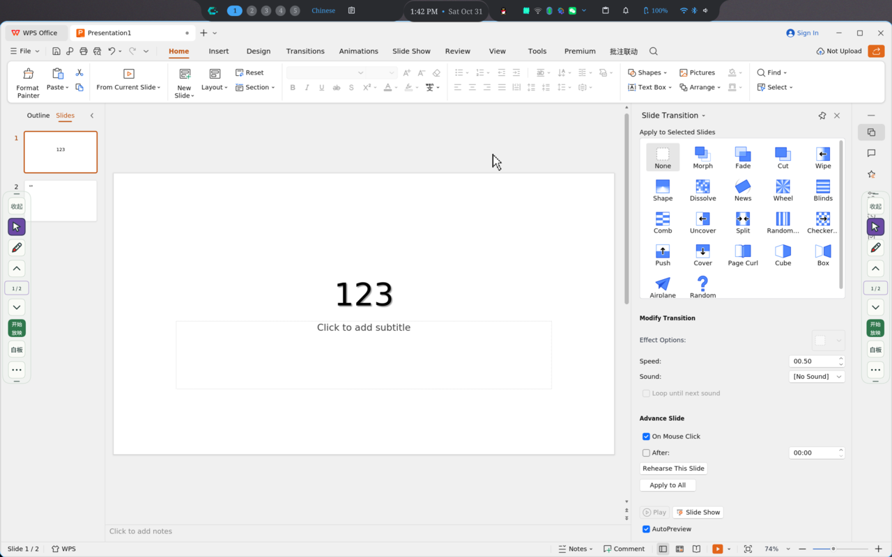
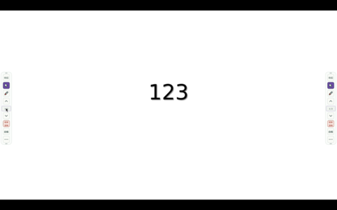
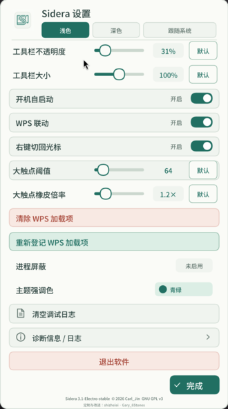
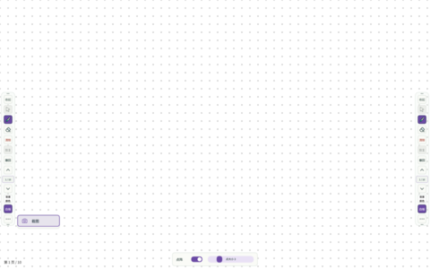
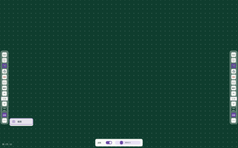
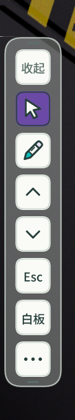
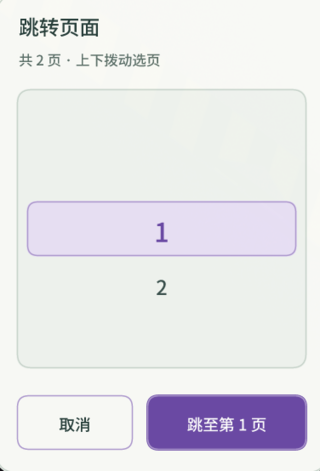

<div align="center">


# Sidera · 星罗

**Linux 课堂批注 · 白板书写 · WPS 演示联动**

轻量、免费、开源：把注意力留给课堂。

[](https://github.com/offduckling4825/Sidera--screen-annotate-for-linux/actions/workflows/ci.yml)
[](https://github.com/offduckling4825/Sidera--screen-annotate-for-linux)
[](#桌面与安装包兼容性)
[](LICENSE)

[界面预览](#界面预览) · [安装与开始使用](#安装与开始使用) · [从源码构建](#从源码构建) · [更新记录](CHANGELOG.md) · [参与贡献](CONTRIBUTING.md) · [安全政策](SECURITY.md) · [许可证](LICENSES.md)

</div>

> **Sidera（星罗）** 原作者为 **Carl_Jin（jinyicheng，第一次 vibecoding）**；本仓库 `offduckling4825/Sidera--screen-annotate-for-linux` 是上游主仓库。
>
> 贡献者 **shizhelei · Gary_6Stones** 在个人 fork 的 [`custom` 分支](https://github.com/shi-zhe-lei/Sidera--screen-annotate-for-linux/tree/custom) 上完成了课堂体验与兼容性改进（浅色/深色主题、GNOME 扩展、原生 Wayland、USB 离线部署套件、测试与文档等）。这些改进现已合并进本仓库的 `main` 分支；其 fork 与 `custom` 分支发布的版本属于第三方构建，**不是上游官方发行版**。原作者版权与署名保持不变。

## 两套并行实现

本仓库包含两套实现，共用同一份 WPS 加载项（`wps-addin/`）与本地 HTTP 桥协议（`127.0.0.1:16666`），可平滑切换：

| 版本 | 技术栈 | 版本号 | 建议场景 |
| --- | --- | --- | --- |
| **Rust 版（主推，active）** | 纯 Rust，**不依赖 Qt / libX11**，tiny-skia 软件渲染 | `3.1-Electro-stable` | X11 与 Wayland 通吃；老机器、国产化教室机；追求轻量与无重量级依赖 |
| **C++ / Qt5 版（legacy）** | C++17 + Qt5 | `3.1-Electro-stable` | 经典实现；长期在 X11 教室环境验证 |

> Rust 运行时只依赖 `libc6` 与 `libgcc-s1`。C++ 与 Rust 包使用相同的 `sidera` 包名，安装会替换已有版本，**二选一安装**。

## 界面预览



*PPT 放映前：工具栏与批注入口就绪，可直接在课件上书写。*

| PPT 放映中 | 设置界面 |
| :---: | :---: |
|  |  |
| 放映时只保留课堂需要的批注与翻页入口。 | 主题、工具栏、触摸、WPS 联动、进程屏蔽与诊断。 |

| 白色白板 | 绿色白板 |
| :---: | :---: |
|  |  |
| 白色白板，可开启点阵辅助。 | 墨绿白板，适合传统课堂板书。 |

| 侧边栏展开 | 侧边栏收起 |
| :---: | :---: |
|  |  |
| 完整工具栏，包含画笔、橡皮、翻页与白板。 | 贴边收起后只保留小角，减少课堂遮挡。 |



*页码跳转：选择页码后确认跳转，避免误触。*

## 核心特性

- 🖊️ **轻量流畅的屏幕批注**：自由画笔、30/60/80 三档橡皮、白板与 10 色色盘；支持多指同时绘画，笔迹随落笔时长由细到粗。
- 🖱️ **智能点击穿透**：光标模式下只响应工具栏与弹窗交互，全屏透明区域完全穿透，不影响底层桌面与课件操作。
- 🧑‍🏫 **白板模式**：一键把透明批注层变为不透明白板（背景可切换墨绿/白），翻页与笔迹完全本地、与外部放映隔离。
- ✋ **手掌/大触点橡皮**：多点或大面积触点（如手背）自动临时当大号橡皮，单点恢复画笔；阈值与倍率可调。
- ↩️ **撤回 / 恢复**：一键撤回最近一笔（最多 12 步）；手动清除后可用“恢复”找回刚才的整页笔迹。
- 📸 **截图**：抓屏保存 PNG 到图片目录并复制到剪贴板（后端能力允许时）。
- 🧮 **白板点阵**：白板底部可开关点阵辅助线，并用滑块调节点大小。
- 🛠️ **托盘与进程屏蔽**：托盘菜单可打开设置、切换批注/光标、白板与退出；设置中可扫描并屏蔽启动后不需要的进程。
- 📊 **WPS 演示联动**：默认启用完整测试模式，提供页码、跳页、从当前页开始、API 上下翻页与放映状态；命令优先走 WebSocket 双向连接，不可用时回退 SSE。**仅在真实换页时切换批注缓存**，页内动画不丢笔迹。
- 🖥️ **跨架构**：原生支持 x86_64 (amd64) 与 aarch64 (arm64)，适配国产化 Linux 教室机。

### 为课堂准备的操作

| 功能 | 当前行为 |
| --- | --- |
| 屏幕批注 | 画笔、橡皮、撤回、清除与恢复；光标模式把工具栏外的点击交还给桌面。 |
| 工具与反馈 | 笔尖跟随所选颜色，橡皮图标随尺寸适度变化；选中态明显，取消悬浮反馈，强化按下反馈。 |
| 绘图工具组 | 默认收起橡皮、清除、恢复与撤回，保留画笔与翻页入口；选画笔展开。清除后保留展开以便点“恢复”；恢复后或翻到别的空页时再按空页规则收回。返回有笔迹页自动展开；白板模式保持展开。 |
| 工具栏拖动 | 上下两个拖拽点，拖动高亮，范围限制在屏幕内；整栏收起后只留边缘小角，不自动弹开。 |
| 白板 | 进入即切换画笔，光标按钮禁用；切回普通模式会清除白板笔迹并回到空白第 1 页，普通批注页笔迹保留。保持原来的白色／绿板切换，底色不跟随界面主题。**退出程序后不持久保存笔迹。** |
| WPS 联动 | 联动在线时显示页码、跳页与放映状态；支持 API 上下翻页、绿色“从当前页开始”和结束放映。真实换页切换批注，页内动画不切换页缓存。 |
| 页码与跳页 | 联动时显示当前页 / 总页数并允许拨轮跳转；白板始终使用自身页码与拨轮。 |
| 未接入 WPS | 上下键与 Esc 回退到桌面支持的直接按键模拟，页码区域隐藏；不因翻页发起共享桌面授权。 |
| 启动与外观 | 浅色、深色或跟随系统，保留课堂配色与触摸反馈；启动页显示实际准备信息，两侧工具栏从中间向上下展开。工具栏大小以 1% 步长调节。 |

放映按钮、页码及翻页不可用时的具体表现见 [WPS 按钮与页码状态](wps-addin/README.md#按钮与页码状态)。

## 桌面与安装包兼容性

**桌面后端支持和 DEB 能否安装是两件事。** 还需要匹配处理器架构与系统库版本。

| 桌面环境 | 实现路径 | 使用边界 |
| --- | --- | --- |
| X11 | 原生 X11 覆盖层与点击穿透 | 不要求 Wayland；触摸取决于设备与 XInput。 |
| GNOME Wayland | 配套 GNOME Shell 原生扩展 | 需要按用户安装扩展；元数据列出 GNOME 46–50，不代表这些版本已逐一实测。 |
| GNOME 兼容入口 | XWayland | 保留兼容路径；特定 Mutter / Xwayland 组合存在系统侧限制，见[兼容性记录](docs/audit/COMPATIBILITY_2026-10-24.md)。 |
| 支持 layer-shell 的 Wayland 桌面 | 原生 Wayland | 输入模拟、截图、剪贴板按合成器协议能力工作；缺少协议时功能可能不可用。 |
| amd64 / ARM64 | 提供两种原生构建的 DEB | 实际依赖见 DEB 的 Depends 和各自 BUILDINFO，真实桌面仍需验收。 |
| 麒麟等发行版 | 需要匹配系统库与桌面环境 | 分别核对架构、glibc 及桌面版本，不能只看处理器名称。 |

### 触摸（X11）
- 优先使用 **XInput 2.2 触摸**（需驱动/服务器暴露触摸类；程序启动时会协商 `XIQueryVersion(2,2)`）。
- 服务器不暴露触摸类时，退回**直接读取内核 evdev**：支持 MT 协议 A/B、接触面积，并自动排除触摸板。
- evdev 需要读取 `/dev/input`（DEB/Arch 包会安装 `uaccess` udev 规则；源码运行时可用设置里的“加入 input 组”授权）。
- 接触面积（手背橡皮）取决于设备是否上报尺寸轴；读不到时按多指路径工作。

## 安装与开始使用

### 1. 安装 DEB

从 Releases 下载对应架构的 DEB 与 `SHA256SUMS`，先核对：

```sh
dpkg --print-architecture
getconf GNU_LIBC_VERSION
```

Rust 版（主推）与 C++ / Qt5 版（legacy）现共用同一版本号与 `sidera` 包名，**二选一安装**：

```sh
sudo apt install ./sidera_3.1-Electro-stable_amd64.deb   # amd64
sudo apt install ./sidera_3.1-Electro-stable_arm64.deb   # arm64
```

> 也可以直接用 `dpkg -i`，但推荐 `apt install ./xxx.deb` 以自动补齐依赖。不要跳过依赖检查或替换系统 libc。

RPM / Arch 包可由源码构建（见下），分别产出 `sidera-3.1-Electro_stable.<arch>.rpm` 与 `sidera-3.1_electro_stable-1-<arch>.pkg.tar.zst`（这两种包格式不允许版本号里带 `-`，用 `_` 代替）。

### 2. 选择桌面入口

- **普通 Sidera**：自动选择可用后端。
- **Sidera（GNOME 原生）**：使用配套扩展。安装后以普通用户执行 `sidera-gnome-install`，首次安装或更新已加载扩展后保存工作、注销再登录。
- **Sidera（兼容模式）**：使用 X11 / XWayland。

切换入口前退出已有 Sidera。更多说明见 [GNOME 扩展](compat/gnome-extension/README.md)；独立的 [Wayland 测试桌面](compat/wayland-lab/README.md) 可用于隔离验证。

### 3. 连接 WPS 演示

关闭 WPS 后，以普通用户执行：

```sh
sidera-wps-addin-install
```

随后**先打开 Sidera**，在设置中开启“WPS 联动”，再打开 WPS 演示。首次登记或更新加载项后需要重新打开 WPS；可用性取决于 WPS 版本提供的加载项 API。详见 [WPS 加载项说明](wps-addin/README.md) 与 [教室部署指南](README.classroom.md)。

启动失败时查看 `${XDG_STATE_HOME:-$HOME/.local/state}/sidera/startup-error.log`。课堂诊断日志写入 `~/sidera-diagnostic.log`，可在“设置 → 诊断信息 / 日志”中直接查看带 `[INFO]/[WARN]/[ERROR]` 级别的最近记录。提交日志前请移除用户名、课件路径及个人信息。

## 从源码构建

### Rust 版

工具链固定为 **1.93.1**（见 `rust/rust-toolchain.toml`）。运行时只依赖 `libc6` 与 `libgcc-s1`，无需 Qt、无需 `libX11`。

```sh
cd rust
cargo build --release --locked     # 产物: rust/target/release/sidera
cargo test --locked
```

**容器编译 + 主机打包（推荐用于发布）**：采用「**2 个编译容器 + 主机打包**」——编译统一在仓库内 sysroot 容器（`amd64-sysroot` / `aarch64-sysroot`，bwrap，低 glibc），三种包从同一二进制产出：

```sh
cd rust
./build_amd64.sh        # 容器编译 + 打包 deb/rpm/arch（amd64）
./build_aarch64.sh      # 同上（aarch64，需 qemu-aarch64-static）
./build_amd64.sh --no-pkg   # 只编译，不打包
```

- 打包工具：`dpkg-deb`（deb）、`rpmbuild`（rpm，支持 `--target aarch64`）、`bsdtar`+`zstd`+`fakeroot`（Arch）。
- 底层脚本：`build_container.sh <arch>`（编译）、`build_deb.sh` / `build_rpm.sh` / `build_arch.sh <arch>`（打包）。
- sysroot **不在仓库中**（体积大、已 gitignore），需自行准备；若本机装了 rustup，`build_container.sh` 会使用固定的 1.93.1 工具链（可用 `SIDERA_RUST_TOOLCHAIN` 覆盖）。
- Arch 源码包配方见 `rust/arch/PKGBUILD`（供 AUR 用户 `makepkg`）。

### C++ / Qt5 版

```sh
# Ubuntu / Debian / Deepin / UOS
sudo apt install -y build-essential pkg-config \
  qtbase5-dev libqt5widgets5 libqt5network5 \
  libx11-dev libxcb1-dev libxext-dev libxtst-dev

cd cpp
make -j$(nproc)            # 本机编译 → cpp/annotate_amd64
./annotate_amd64
```

或用仓库内容器脚本：`cpp/build_amd64.sh` / `cpp/build_aarch64.sh`（容器编译 + 打 DEB）。

## 项目结构

```
.
├── rust/         # Rust 版（主推）：Cargo 工程 + 构建/打包脚本 + 新增现代 UI/主题/Wayland 模块
├── cpp/          # C++ / Qt5 版（legacy）：Makefile、src/、打包脚本
├── protocols/    # Wayland 协议 XML（两版共用）
├── wps-addin/    # WPS JS 加载项（两版共用）
├── compat/       # GNOME 扩展、独立 Wayland 测试桌面、特定环境修补
├── tools/        # 测试/发布辅助（隔离运行、DEB 依赖、USB 离线套件等）
├── docs/         # 预览、审计、测试与设计文档
└── README.md / LICENSE / LICENSES.md / NOTICE.md
```

Rust 源码要点（`rust/src/`）：`main.rs`（入口/事件/触摸路由）、`app.rs`（状态/配置/分页缓存）、`ui.rs` 与 `ui_theme.rs`/`ui_icons.rs`（手绘 UI 与主题）、`paint.rs`（tiny-skia 笔迹）、`gesture.rs`（手背/多指 FSM）、`x11.rs`（覆盖层/XShape/XTest/触摸）、`wayland*.rs`（layer-shell/原生 Wayland）、`wps.rs`（本地 HTTP/WebSocket 桥）、`touch_evdev.rs`（evdev 触摸）、`uinput.rs`（内核虚拟键盘）等。

## 路线规划与 Wayland 适配

- **Rust 版原生支持 Wayland**：通过 `wlr-layer-shell`（niri/sway/hyprland 等）实现 Overlay 层置顶与 `wl_surface` 输入区域；无 `zwp_virtual_keyboard` 的合成器回退到 `uinput`。
- **X11 兼容**：`x11rb` 直连（ARGB 覆盖层 + XShape 穿透 + XTest 注入），不依赖 `libX11`/`libXtst`。
- **触摸**：优先 XInput 2.2；无触摸类时用 evdev。
- **截图**：X11 直接抓屏；Wayland 无 `wlr-screencopy` 时走 `xdg-desktop-portal`。
- **WPS 联动解耦**：已完成加载项 WebSocket 双向通信，SSE 保留为回退通道。
- **全局快捷键迁移**：接入现代 Linux `org.freedesktop.portal.GlobalShortcuts` 协议。

## 项目导航

| 栏目 | 内容 |
| --- | --- |
| [更新记录](CHANGELOG.md) | 面向使用者的版本变化与已知限制 |
| [贡献指南](CONTRIBUTING.md) | 分支约定、构建、反馈与提交方式 |
| [安全政策](SECURITY.md) | 私密漏洞报告、权限范围与维护边界 |
| [许可证说明](LICENSES.md) · [GPL 原文](LICENSE) | 上游授权与第三方许可的关系 |
| [作者与致谢](NOTICE.md) | 原作者与本分支贡献归属 |
| [项目分析](docs/PROJECT_ANALYSIS.md) · [问题清单](docs/ISSUES.md) | 架构评审与尚待解决的问题 |
| [重构计划](docs/REFACTOR_PLAN.md) · [测试环境](docs/TEST_ENVIRONMENT.md) | 后续改进顺序与验证记录 |
| [功能待办](TODO.md) | 留待后续实现的应用避让、常驻音频按钮与播放/静音提示 |

## 贡献 · 许可证 · 安全

- C++ 版提交前请确保 `make clean && make` 通过。
- Rust 版提交前请确保 `cd rust && cargo test --locked && cargo clippy --all-targets` 通过。
- 建议保持轻量、无冗余依赖的设计理念。

欢迎通过 [Issue](https://github.com/offduckling4825/Sidera--screen-annotate-for-linux/issues) 反馈可复现的问题。安全问题请使用私密漏洞报告，不要在公开 Issue 附带敏感信息。

**本项目沿用 GNU GPL v3，并非 MIT 项目。** 原作者版权与许可原文保留在 [LICENSE](LICENSE)；第三方组件若采用 MIT 等许可，仍遵循各自的声明，详见 [许可证说明](LICENSES.md)。感谢上游 Sidera、`custom` 分支贡献者及所有依赖项目。
