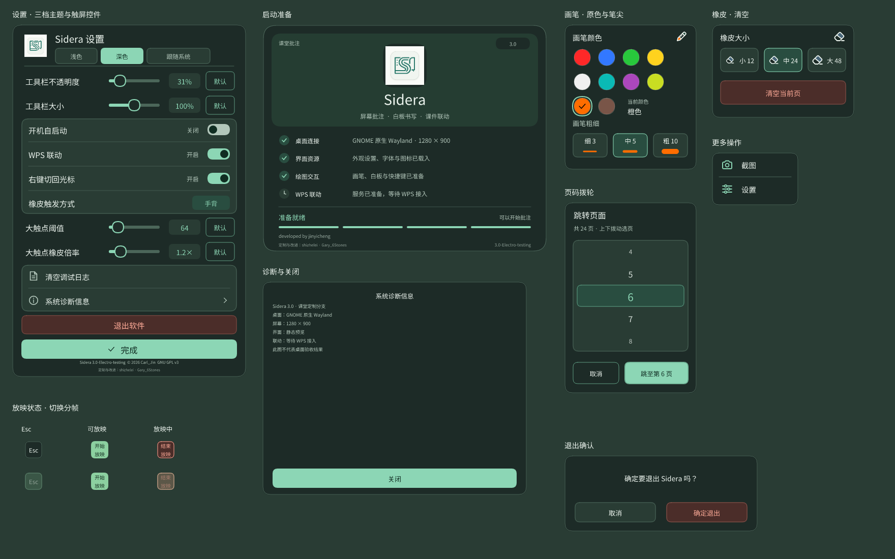

# 浅色、深色与跟随系统

更新：2026-10-25，`custom` 分支。适用于当前 **Rust 3.0** 界面；仓库保留的上游 C++ / Qt5 2.6 不包含这套主题功能。主题功能从 custom.34 起提供，当前 [custom.35 Release](releases/2026-10-25-custom35.md) 另修复小屏幕设置；历史 custom.29 安装包不包含本功能。

## 使用

点工具栏「更多 → 设置」，在标题下选择 **浅色、深色或跟随系统**。切换立即生效，并保存到 XDG 配置目录中的 `sidera/config`；下次启动包括启动页都会使用保存的选择。旧配置缺少主题字段时继续使用浅色。

深色采用深灰绿面板、柔和浅色文字和薄荷绿选中态，保留现有工具位置、正文尺寸、无悬浮反馈和按下高亮。浅色保持原有暖白课堂风格。

| 界面 | 处理范围 |
| --- | --- |
| 工具栏 | 光标、画笔、橡皮、清除、撤回、翻页、白板、更多；展开/折叠、贴边把手、两端拖动高亮、禁用与按下状态 |
| 工具面板 | 全部色块、笔尖、粗细预览、橡皮三档、清空按钮、面板边框 |
| 翻页与联动 | 当前页/总页数、拨轮及取消/跳转按钮、邻近数字、Esc/开始/结束放映的动作颜色过渡；上下翻页不可用时的提示色 |
| 设置 | 标题与主题选择、滑条、参数、默认按钮、开关、状态文字、日志、诊断、退出与完成、原作者及辅助署名 |
| 弹窗与启动 | 更多菜单、诊断信息、退出确认；启动品牌区、准备状态、警告、进度、淡出及工具栏展开的临时图层 |
| 白板 | 底色保持原来的白色／绿板；工具界面跟随主题，页码和背景按钮按实际底色选字色 |
| 多屏与后端 | X11/XWayland、GNOME 原生、layer-shell 共用同一绘制与主题状态；所有输出同步，新接入输出继承当前选择 |

软件标志保持原有图案与品牌配色。画笔的实际 RGB 值和课件/桌面图像不做反色处理，避免改坏批注含义。透明工具栏仍按用户设置与底下的桌面混合；选择深色不会偷偷改变透明度。



## 白板与内容

白板底色沿用原来的逻辑：启动默认为白色，通过「背景颜色」按钮在白色和绿板间切换。界面无论处于浅色、深色还是跟随系统，都不会改变白板底色；不新增主题底色选项，也不改变原有的背景选择保存方式。此前 `.32` 的实验性背景配置会被忽略。

笔迹按选择的颜色原样保存。例如白笔画在白纸上仍是白色；需要保持可见时可选深色背景或换笔色。切回普通模式会清除白板笔迹并回到空白第 1 页；退出整个程序后仍不保存笔迹，这一点与此前相同。

## 跟随系统

通过 [XDG Settings Portal](https://flatpak.github.io/xdg-desktop-portal/docs/doc-org.freedesktop.portal.Settings.html) 的只读 `org.freedesktop.appearance/color-scheme` 获取桌面偏好。使用兼容旧版 Portal 的 `ReadAll`，不会调用截图、录屏或远程控制接口，不应出现共享桌面授权。

正常约 2 秒检查一次；单次读取最多等 750 毫秒，运行中的读取在后台线程完成。首次启动短暂等待初值，避免已保存的跟随系统在启动页先闪成浅色。服务重启或读取失败保留最后已知值并稍后重试；从未读到有效值、系统无偏好或不提供该接口时采用浅色，手动选择深色始终可用。

## 实现与验证

- [ui_theme.rs](../rust/src/ui_theme.rs) 定义语义配色与文字对比色；绘制上下文携带主题，包含动画临时画布。
- [system_theme.rs](../rust/src/system_theme.rs) 负责有时限的只读检测；[app.rs](../rust/src/app.rs) 保存偏好、更新主题及启动缓存。
- [render_themes.rs](../rust/examples/render_themes.rs) 调用实际绘制函数，生成两套面板、工具栏状态、白板背景与课堂示意；不启动桌面或 WPS。预览见 [图片目录说明](assets/preview/README.md)。

隔离检查覆盖三档配置往返与无效值、真实 D-Bus 编码和偏好变化（私有模拟服务）、主要文字/按钮及拨轮对比度、1×/1.5×/2×全部面板绘制、启动缓存换色、多屏同步，以及白板底色/笔迹/页码/撤回保留。命令：

本轮普通 Rust 用例 **103 项通过**，另外 **11 项私有 Xvfb** 和 **2 项私有 Sway** 检查通过；发布二进制的 **16 项启动诊断** 通过。新增的 8 项主题用例在普通测试内；Clippy 完成，保留原有代码风格提示，主题代码未新增提示。

```sh
python3 tools/test_rust.py theme
python3 tools/test_rust.py
python3 tools/test_rust.py --x11
python3 tools/test_rust.py --wayland
```

图像检查与隔离协议检查不能替代实机操作。由用户在真实桌面验收：切换三档并重启程序、系统明暗切换、WPS 放映、绘图穿透、白板往返、多个显示器与触屏。不能据此宣称所有桌面版本已经通过。

## 公开包与本地测试包

`custom.35` 的 amd64 和 ARM64 包都包含本页主题功能，并保持白板原有底色。两种架构以 Ubuntu 22.04 分别原生构建，实际系统库依赖与检查结果见 Release 中对应架构的 `BUILDINFO`；不要将下面旧 `.33` 本地包的 glibc 要求套用到新公开包。

2026-10-25 已从源码 `31ef325a473c46bbe379b404efc7ce43f181ff6a` 编译并覆盖安装 **3.0-Electro-testing+custom20261025.33** 到 VMware Ubuntu 26.04.1 amd64。此版保留原来的白板底色；包要求 libc6 ≥ 2.43，不能作为 Ubuntu 24.04 或麒麟 ARM64 的安装包。

- 安装状态为 `install ok installed`，37 个安装文件的 SHA-256 与包内容一致。
- 原有用户配置校验一致，GNOME 扩展文件未变化；此次更新不需要重新登录桌面。
- 安装保留旧 Sidera 进程，退出并重开 Sidera 后使用新版；未操作真实桌面或 WPS。
- 旧包与二进制保留在虚拟机的 `/var/backups/sidera-compat-20261025/`。

包 SHA-256：`e23a89cd7fe485fea137cff250b18ed0db1ebdac65762cda2579fbf6927814d7`。

程序 SHA-256：`7b1f27763f45967bf863cadd327e2c2a4fb9c6ef11baba89fe24ca12cb50e0cc`。
