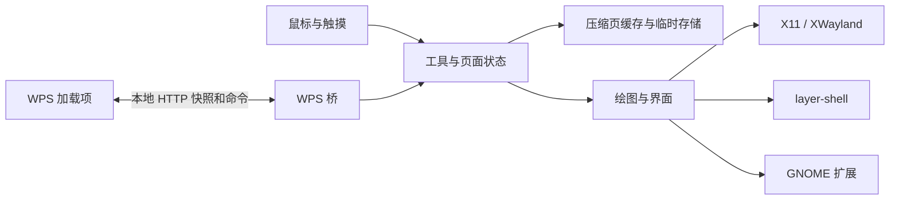

# Sidera 项目分析

更新：2026-10-24；分支 `custom`。本页描述当前工作区；已发布的 custom.29 不包含本轮复查修改。最初 2026-09-30 分析及历次版本可从 Git 历史追溯。

## 当前结论

Rust 是课堂定制功能的主要实现，支持原生 X11、GNOME 扩展、layer-shell，以及 GNOME 上的 XWayland 兼容路径。C++ 保留维护，本轮修复共享桥、缓存和 Wayland 缓冲生命周期；它没有同步 Rust 的全部课堂界面与 GNOME 原生能力。

本轮针对旧 S01–S28 清单重新对照代码，并执行获准的隔离检查。已修复的代码缺陷与尚需硬件、真实 WPS、目标系统验证的事项分开记录；不把一次通过当作所有桌面兼容的证明。

- [问题状态与剩余工作](ISSUES.md)
- [下一步重构计划](REFACTOR_PLAN.md)
- [测试环境及命令](TEST_ENVIRONMENT.md)
- [浅色/深色主题与验证范围](DARK_MODE.md)
- [本轮复查证据](audit/REVIEW_2026-10-24.md)
- [历次记录索引](audit/README.md)

## 结构与职责

| 部分 | 当前职责 | 维护边界 |
| --- | --- | --- |
| Rust App / main / toolbar / UI | 画布、白板、工具、触摸交互、课堂界面与动作路由 | main 仍承担较多控制逻辑，后续按状态边界拆分 |
| Rust Desktop | GNOME/layer-shell 的逐屏画布、工具同步和共享 WPS | 混合 DPI、真实热插拔仍需实机验收 |
| Rust X11 / Wayland / GNOME | 窗口、输入区域、协议、显示提交和能力反馈 | GNOME 扩展与 XWayland 是不同路径 |
| Rust page_cache / persistence / instance | 无损压缩页缓存、原子替换、单实例锁与唤醒 | 临时缓存不是退出后的文档保存 |
| Rust WPS / bridge_http | 放映快照、命令队列、有界 HTTP、加载项登记 | 保留旧 GET 协议；尚无完整客户端认证 |
| Rust portal / clipboard | 有界截图请求、持久剪贴板服务 | 真实粘贴和各桌面 Portal 仍需验证 |
| C++ WpsBridge / PageCache | X11 与 Wayland 共用桥、登记和缓存规则 | UI、输入与部分放映状态仍分别实现 |
| C++ Widget / WlBackend | Qt X11 与裸 layer-shell 显示、交互 | 单输出 Wayland；不支持 GNOME 扩展 |
| WPS 加载项 | 状态快照、API 翻页、当前页开始、绝对跳页 | 新功能以 Rust 侧支持为准；模拟 API 不能代替真实 WPS |
| compat | GNOME 扩展、可切换 Sway 测试桌面、特定 Xwayland 回补 | 系统补丁只适用于其明确记录的版本 |

C++ 只使用前两种显示路径。GNOME 扩展负责显示和受限输入转发，业务绘图仍在 Rust 中。

## 数据与生命周期

透明批注和白板拥有独立页缓存；白板保留 10 个可切换页面。关闭白板保存内容和页码，外部放映变化更新透明批注状态，不能清除白板。程序退出后临时缓存随之释放，当前没有跨启动恢复功能。

页缓存不再按“20 页/2 页”静默丢弃。每份缓存以 32 MiB 压缩数据为内存预算，超出后写入私有临时目录；存储失败优先保留内存并记录错误。这不是整个进程的内存硬上限：每个输出、白板、画布、撤回和临时编解码都有额外成本。

Wayland 正在被合成器使用的存储不能改写。Rust 使用独立帧槽；C++ 在尺寸变化时保留正在显示的旧存储，提交替代画面后再按 release 回收。几何、输入区域及匹配缓冲一起更新；已有笔迹和旧页恢复时按新尺寸重采样，旧尺寸撤回记录作废。

## WPS 协议现状

仅携带状态的轮询代表联动在线，问候或静态资源访问不算。定期快照可恢复桥重启后的当前页；开始、结束、断线及白板各有独立处理。命令队列最多 8 条、有效期 1.5 秒，断线/结束/白板切换会清理待执行命令。

新加载项通过 `sid/seq` 标记请求流，桥拒绝同一流的重复及倒序请求；文稿标记 `deck` 用于识别可观察到的文档切换。这些字段不是认证。多个加载项窗口、旧协议客户端以及文稿标记不可用时，仍需要完整会话协议，见 S12。

## 构建与证据边界

Rust 工具链固定为 1.93.1，构建锁定 Cargo.lock。C++ 可显式选择 `WITH_WAYLAND=0/1`，配置变化使旧对象失效。三个 DEB 入口从实际 ELF 生成依赖，失败时保留已有包；旧系统可运行性仍需在对应系统构建和验收。

当前可重复运行单元、接口、Xvfb 和私有 Sway 协议检查。GNOME 模拟模块测试不等于 Shell 交互验证。CI 已配置 custom/main 触发，但本地通过不代表远程 CI 已执行。

仍待建立可校验的低 ABI rootfs、原生 ARM64 验证、教室触屏/多屏及长课性能记录。学校报告是银河麒麟 V10 SP1 / Phytium ARM64 / UKUI X11 / glibc 2.31；当前 Ubuntu 26.04 amd64 制品不能直接用于该机器。Ubuntu 24.04 也没有完成安装启动验收。
