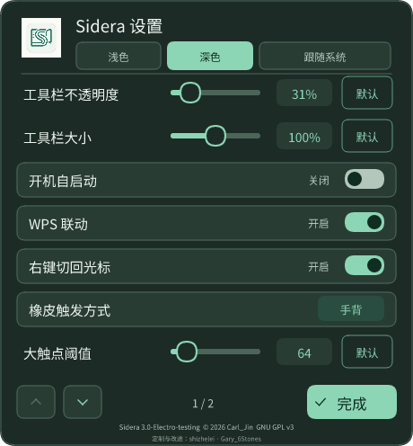
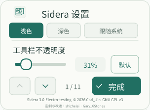

# custom.35 · 小屏幕设置修复

版本：`3.0-Electro-testing+custom20261025.35`。基于原版 Sidera 的课堂定制预发布版，保留原作者署名与 GPL v3；不是上游官方发行。

[Release 与构建附件](https://github.com/shi-zhe-lei/Sidera--screen-annotate-for-linux/releases/tag/v3.0-Electro-testing-custom20261025.35) · [安装方法](../../README.md#安装与开始使用) · [U 盘离线工具](../../tools/usb-kit/README.md)

## 修复内容

旧设置面板使用固定高度，低分辨率或较大系统缩放下，底部设置和“完成”会被裁掉。现在面板尺寸依据可用屏幕重新计算：

- 设置内容按完整行分页；上下按钮、鼠标滚轮可切换，底部一直显示“完成”和设置页码。
- 窄屏滑条分两行，文字维持正常大小；不会把整张面板缩成低清位图。
- 窗口尺寸改变或橡皮触发方式变化后，页码自动回到有效范围；重新打开从第一页开始。
- 深浅主题使用相同布局和点击范围；诊断与退出确认也限制宽高，诊断关闭按钮保留在屏幕内。
- 白板保持原来的白色／绿板，笔迹、课件联动、工具栏位置与收放逻辑不变。

隔离布局检查覆盖逻辑分辨率 320×240、360×640、480×270、640×360、980×512、1024×600、1280×720、1920×1080，以及 100% / 150% / 200% 绘制比例。检查每项设置均可到达、操作区域不重叠、完成按钮可见和输出像素尺寸；这不是现场触摸或桌面验收。

由实际界面绘制代码离线生成的预览：

## 安装与验证

发布构建的 amd64 / ARM64 各通过 136 项隔离检查（107 Rust、11 X11、2 Wayland、16 启动），[双架构工作流](https://github.com/shi-zhe-lei/Sidera--screen-annotate-for-linux/actions/runs/40124628783)与[常规 CI](https://github.com/shi-zhe-lei/Sidera--screen-annotate-for-linux/actions/runs/40124628700)均通过。学校 ARM64 低 ABI 构建另通过 107 项普通 Rust、16 项启动检查；离线安装器 31 项及整套安装、自启接管和恢复流程检查通过。

VMware 已覆盖安装 custom.35，37 个文件校验通过，用户配置与旧进程保留。U 盘当前 51 个文件校验完成，并保留上一套安装资料；这些结果不代替用户的真实桌面操作验收。

标准 amd64 / ARM64 DEB 从同一标签，在对应架构 Ubuntu 22.04、Rust 1.93.1 环境构建。实际动态库依赖、源码提交、每项测试与文件哈希以 Release 的 `BUILDINFO`、`TEST-RESULTS.tar.gz`、`SHA256SUMS` 为准。

学校麒麟 ARM64 / glibc 2.31 使用 U 盘内另行构建的低 ABI 包，按同一源码、锁定依赖编译，并在 QEMU 与真实 glibc 2.31 库下执行隔离检查；它与标准 ARM64 DEB 不可混淆。安装器只并存安装到用户目录，保留原系统包、原配置、自启恢复记录和详细日志，全程离线。

安装更新后保存需要保留的批注，退出并重新打开 Sidera。此次没有修改 GNOME 扩展或 WPS 加载项，无需为本次主程序更新注销桌面。真实 VMware、学校电脑、触屏与 WPS 操作仍由使用者验收。

历史 [custom.34](2026-10-25-custom34.md) 保留原始发行记录。
